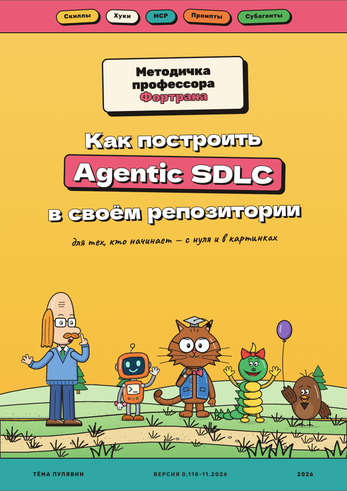
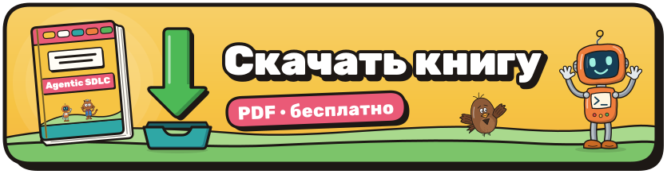
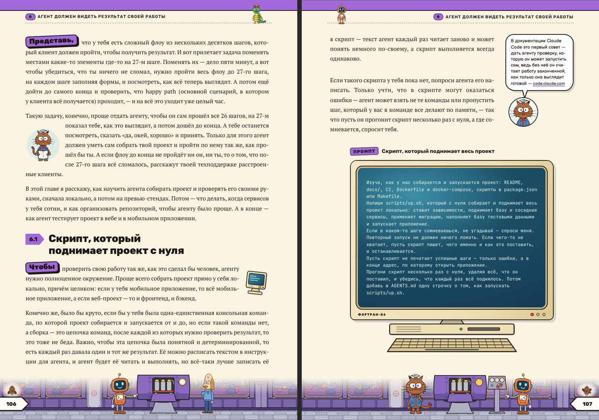

<p align="center">
  
</p>

<p align="center">
  <a href="https://github.com/pulyavin/agentic-sdlc/releases/latest/download/agentic-sdlc.pdf"></a>
</p>

<h1 align="center">Как построить Agentic SDLC в своём репозитории</h1>

<p align="center">
  <b>«Методичка профессора Фортрана»</b> — иллюстрированная книга о том, как подготовить<br>
  репозиторий и процесс разработки к работе с AI-агентом
</p>

<p align="center">
  <a href="https://github.com/pulyavin/agentic-sdlc/releases/latest/download/agentic-sdlc.pdf"><b>Скачать PDF</b></a>
  ·
  <a href="https://github.com/pulyavin/agentic-sdlc/releases">Все версии</a>
  ·
  <a href="CONTRIBUTING.md">Как помочь</a>
</p>

<p align="center">
  <a href="https://github.com/pulyavin/agentic-sdlc/actions/workflows/check.yml"></a>
  <a href="https://github.com/pulyavin/agentic-sdlc/releases/latest"></a>
  <a href="LICENSE"></a>
</p>

---

В неподготовленном репозитории агент пишет слоп: он не знает ваших договорённостей, не умеет запустить проект и не
замечает собственных ошибок. Эта книга шаг за шагом проводит через подготовку репозитория и процесса — от `AGENTS.md`
до конвейера, в котором агент ведёт задачу от запроса до прода, — и на каждом шаге даёт промпт, который можно сразу
запустить у себя. А по пути тебя сопровождают профессор Фортран, Кот, Воробей, Гусеница и Агент.

<p align="center">
  
</p>

## Что внутри

| | Глава |
|---|---|
| | Введение |
| 1 | Почему агент пишет слоп |
| 2 | Выбираем модель и инструмент |
| 3 | MCP: подключаем агента к твоим сервисам |
| 4 | Что агенту нужно знать о проекте |
| 5 | Скиллы — инструкции на каждый день |
| 6 | Агент должен видеть результат своей работы |
| 7 | Агент сам находит свои ошибки |
| 8 | CI — последний рубеж перед main |
| 9 | Код-ревью, когда код пишут агенты |
| 10 | Как не дать агенту всё сломать |
| 11 | Как теперь выглядит разработка |
| | Заключение |

## Этот репозиторий — тоже пример

Репозиторий устроен так, как советует книга, поэтому каждую её идею можно посмотреть на живом проекте:

| В книге | Здесь |
|---|---|
| Инструкции для агента | [`AGENTS.md`](AGENTS.md) |
| Скиллы для повторяющейся работы | [`.claude/skills/`](.claude/skills) — собрать книгу, проверить главу, поднять версию |
| Решения, которых не видно в коде | [`docs/adr/`](docs/adr) |
| Агент сам узнаёт о своих ошибках | тесты, линтер и `book audit`, который проверяет каждую страницу |
| CI — барьер перед `main` | [`check.yml`](.github/workflows/check.yml) на каждый пул-реквест |
| От merge до прода | [`release.yml`](.github/workflows/release.yml) выпускает PDF на каждый merge, который поднимает версию |

## Как собирается книга

Главы написаны в Markdown с несколькими своими блоками: сноски героев, промпты в нарисованных мониторах, таблицы,
шаги. Инструмент на Python превращает их в HTML, Google Chrome раскладывает каждую страницу и печатает векторный
PDF, а все рисунки — герои, сцены, миры глав — генерируются кодом.

```bash
cd tools
uv sync
uv run book build --strict                          # ../book -> ../dist/agentic-sdlc.pdf
uv run book audit --baseline audit-baseline.json    # собрать книгу и проверить каждую страницу, как в CI
uv run book build --demo                            # витрина всех блоков
uv run pytest                                       # тесты
```

Нужны [uv](https://docs.astral.sh/uv/) и Google Chrome. Подробнее — в [`docs/build.md`](docs/build.md) и
[`docs/design-system.md`](docs/design-system.md) (на английском).

## Как помочь

Нашёл опечатку, неточность или устаревший факт? Сделай пул-реквест или заведи issue — как это устроено, написано в
[CONTRIBUTING.md](CONTRIBUTING.md). CI соберёт книгу и проверит каждую страницу, а каждый merge с новой версией
становится новым релизом. А звёздочка подскажет автору, что книгу стоит развивать дальше.

## Автор

Тёма Пулявин, бывший технический директор каршеринга Ситидрайв —
[блог «Быть Лидом»](https://t.me/tobelead) · [Telegram](https://t.me/puliavin).

Герои книги — дань уважения «Энциклопедии профессора Фортрана» А. В. Зарецкого, М. О. Зарецкой, А. В. Труханова и
художницы Э. Л. Десятник; все рисунки в этом репозитории оригинальные.

## Лицензия

- Текст и картинки книги, кроме фото автора: [CC BY-NC 4.0](https://creativecommons.org/licenses/by-nc/4.0/deed.ru) —
  делись и переделывай, указывая автора и книгу, но не продавай.
- Промпты, команды и примеры кода из книги: [CC0 1.0](https://creativecommons.org/publicdomain/zero/1.0/deed.ru).
- Инструмент сборки: [PolyForm Noncommercial 1.0.0](https://polyformproject.org/licenses/noncommercial/1.0.0).
- Шрифты: SIL Open Font License 1.1.

Подробно — в [LICENSE](LICENSE).
